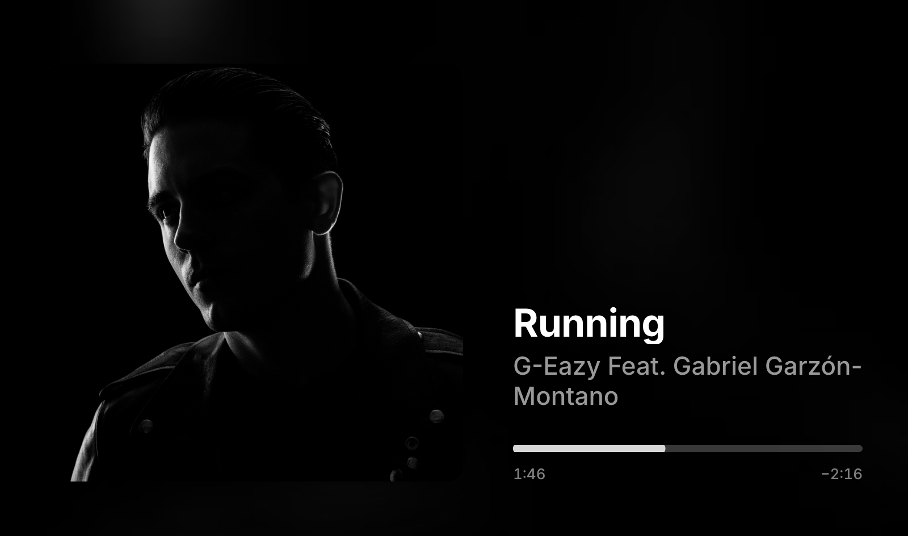
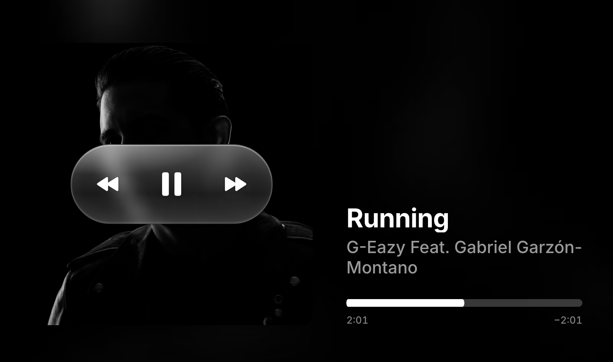
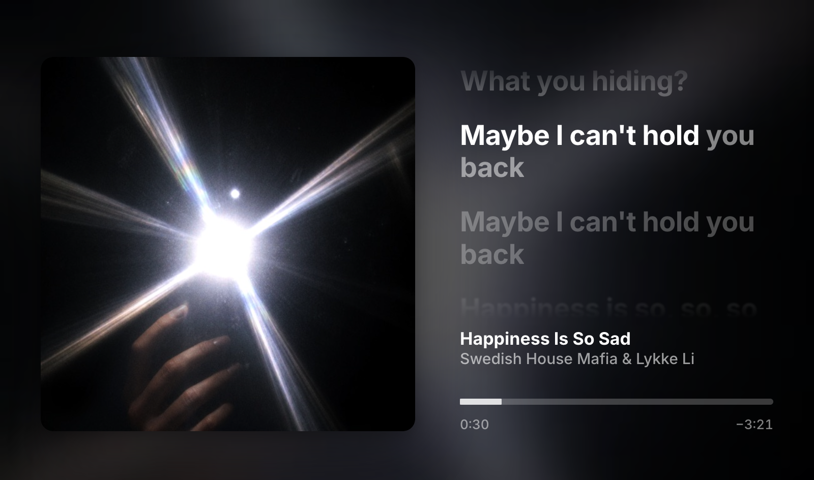
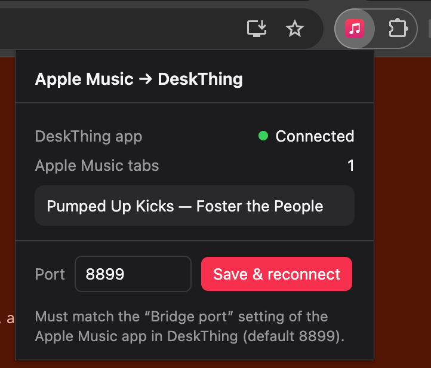

# AppleMusicThing

Apple Music on the Spotify Car Thing. A [DeskThing](https://github.com/ItsRiprod/DeskThing) app (DeskThing is the open-source Car Thing OS by [Riprod](https://github.com/ItsRiprod)) and a small browser extension that turn the Car Thing into an album-art-first now playing screen for Apple Music on the web, with synced lyrics that fill in word by word as they're sung.



<table>
  <tr>
    <td width="50%"></td>
    <td width="50%"></td>
  </tr>
  <tr>
    <td>Tap for controls</td>
    <td>Lyrics, synced to the song</td>
  </tr>
</table>

## Why this exists

I found my Spotify Car Thing in a bin in the garage. I remembered reading about DeskThing, so I flashed it and got it running. But I'm an Apple Music subscriber, and the local media player that comes with DeskThing didn't look the way I wanted. I wanted something that felt like an official Apple Music device sitting on my desk: big album art, lyrics that fill in as they're sung, and controls that just work.

This is the result. I use it every day. Next up is a 3D-printed mount to put it under my monitor or my desk, whichever wins.

## What it does

- Shows the current song from Apple Music in Edge or Chrome: art, title, artist and progress, styled after Apple Music's own now playing screen.
- Controls playback from the Car Thing: dial for volume, press for play/pause, swipes to skip, tap for on-screen controls, drag to seek.
- Shows lyrics with a press of the back button. They come from Apple Music itself when available, so word-timed songs fill in exactly as they do in Apple Music. When Apple has none, the app falls back to [LRCLIB](https://lrclib.net) and estimates word timing from syllables.
- Loads the next song's lyrics and art ahead of time, so they appear the moment it starts.
- Works on Windows 11 and macOS, including on managed work networks (lyrics can be fetched through the browser when the computer's own requests are blocked).

## How it works

```
music.apple.com tab ──▶ browser extension ──▶ DeskThing app (on your computer) ──▶ Car Thing screen
   (Edge / Chrome)       reads the player,      127.0.0.1:8899, lyrics,              art, lyrics,
                         sends commands         settings, button actions             controls
```

- **`extension/`**: Now Playing Bridge for DeskThing, the browser extension. Reads what's playing in your music.apple.com tab, fetches Apple's lyrics for it, and carries out play/pause, skip, seek and volume.
- **`app/`**: the DeskThing app. Its server side runs inside DeskThing on your computer and talks to the extension; its screen runs on the Car Thing.

For the full technical tour (how the player is read, where lyrics and art come from, the local bridge, and how the Car Thing keeps it smooth) see [How it works](docs/HOW-IT-WORKS.md).

## Requirements

- A Car Thing already running DeskThing. If yours isn't set up yet, follow DeskThing's [setup video](https://www.youtube.com/watch?v=iW2biAnq0n8) and the Thing Labs [flashing guide](https://carthing.wiki/first-steps/flashing).
- The DeskThing desktop app from [deskthing.app](https://deskthing.app/releases).
- Microsoft Edge or Google Chrome, signed in to [music.apple.com](https://music.apple.com) with an Apple Music subscription.

## Install

### 1. The browser extension
1. Download this repo (or the release's `now-playing-bridge-v1.4.0.zip`) and keep the `extension` folder (or the unzipped files) somewhere permanent; the browser loads it from that folder.
2. Open the extensions page (`edge://extensions` in Edge, `chrome://extensions` in Chrome), turn on **Developer mode**, click **Load unpacked**, and pick the `extension` folder.
3. Reload any open music.apple.com tab.

### 2. The DeskThing app
1. Get `applemusic-v1.7.2.zip` from the Releases page (or build it, see below). In DeskThing, open **Apps**, choose to add an app from a file, and pick that zip.
2. Open the app on the Car Thing.
3. Click the extension's toolbar icon (in Chrome, pin it from the puzzle-piece menu first). It should say **Connected** and show the current song.

   

## Using it

| Input | Does |
|---|---|
| Tap the screen | Show play / pause, previous, next and a bigger scrub bar; they fade after a few seconds |
| Drag the bar (while controls show) | Seek |
| Swipe left / right | Next / previous song |
| Swipe up / down | Volume up / down |
| Turn the dial | Volume |
| Press the dial | Play / pause |
| Hold the dial | Next song |
| Press the back button (below the dial) | Show / hide lyrics |
| Hold the back button | DeskThing app list, as before |

Previous restarts the song if you're more than 3 seconds in, like a car stereo. Volume is Apple Music's own volume slider, not the system volume.

In a desktop browser (DeskThing's client page), the same inputs are a click, a quick drag, the mouse wheel, **Enter** and **Esc**.

### Settings (DeskThing → Apps → Apple Music)

- **Lyrics button**: which hardware button toggles lyrics, or *None* to set it in button mappings instead.
- **Volume step**: 2, 5 or 10% per dial click or swipe.
- **Bridge port**: default 8899. If you change it, set the same port in the extension popup.

The app also registers mappable actions (**Apple Music: Play / Pause, Next, Previous, Volume Up, Volume Down, Toggle Lyrics**) so you can put them on any button in a mapping profile.

## Platforms

- **Windows 11** and **macOS**: both tested. The app zip and the extension are the same on both.
- **Browsers**: Microsoft Edge or Google Chrome. Other Chromium browsers that allow unpacked extensions should work but aren't tested.
- Use one browser at a time for Apple Music. If both have the extension and an Apple Music tab open, the most recent connection wins.

## Troubleshooting

- **"Waiting for the browser" on the Car Thing**: the extension isn't connected. Check the popup. If it says not reachable, make sure DeskThing is running and the ports match. If another program is using port 8899, DeskThing's logs will say so; pick another port.
- **Popup connected but nothing playing**: reload the Apple Music tab once after installing the extension.
- **The extension shows up in DeskThing as "Unknown Device"**: its port is set to DeskThing's own port. Set it back to the app's Bridge port (8899).
- **"No lyrics found"**: neither Apple Music nor LRCLIB has lyrics for that song.
- **"Couldn't reach the lyrics service"**: the app tries lrclib.net directly first; if the computer's network blocks that (common behind a company proxy, which DeskThing doesn't use), it fetches through the browser instead. If it still fails, check that `https://lrclib.net/api/search?q=hello` opens in your browser; if it's blocked there, a web filter is blocking the site.
- **An update doesn't seem to apply on the Car Thing**: fully close and reopen the app on the Car Thing; it can keep showing a cached copy.

## Privacy and security

No accounts, servers or analytics: song info goes only to the DeskThing app on your own computer, plus lrclib.net lookups when Apple has no lyrics. Full details in the [privacy policy](PRIVACY.md).


- The bridge listens on `127.0.0.1` only and refuses connections that don't come from a browser extension, so websites can't control playback through it.
- The extension only runs on music.apple.com. Besides local storage for the port number, it can reach lrclib.net, and it only fetches lrclib.net URLs on the app's behalf, so the app can't use it as a general proxy.

## Publishing the extension

Store-ready listing text, permission justifications, data-use answers and images for the Chrome Web Store and Microsoft Edge Add-ons are in [`store/LISTING.md`](store/LISTING.md). Build the upload zip with `store/package.sh`.

## Releasing

Releases are built by GitHub Actions ([`.github/workflows/release.yml`](.github/workflows/release.yml)). Bump `version` in `app/deskthing/manifest.json` and `app/package.json` (and in `extension/manifest.json` if the extension changed), commit, then push a matching tag:

```
git tag v1.7.2
git push origin v1.7.2
```

The workflow builds the DeskThing app and the extension and publishes a release with `applemusic-v<version>.zip`, `now-playing-bridge-v<version>.zip` and `latest.json`, which DeskThing uses to find updates.

## Building from source

```
cd app
npm install
npm run build        # → app/dist/applemusic-v1.7.2.zip
npx vite             # preview the screen in a browser with demo data
```

Preview URLs: `?view=lyrics`, `?controls=1`, `?track=2` (long title), `?state=empty`, `?state=offline`.

```
app/
  server/      runs inside DeskThing on the computer: extension bridge, lyrics, actions, settings
  src/         the Car Thing screen (React); glass.ts renders the backdrop and glass
  shared/      message and type definitions used by both
  deskthing/   app manifest and action icons
extension/     the browser extension for Edge or Chrome (Manifest V3, no build step)
docs/          screenshots and HOW-IT-WORKS.md
store/         browser store listing text, images, and package.sh for the upload zip
```

## How this was built

This project was built with AI assistance. The code, documentation, store listing and images were written by Claude (Anthropic's AI assistant) in conversation with me. It worked in a cloud workspace and committed straight to this repo, which is why commits carry a `Co-Authored-By: Claude` line. I set the direction and design, tested every version on my own Car Thing on Windows 11 and macOS, reported what was off (lyric timing, stutters, outlines, how close it looked to Apple Music), and decided what shipped. The screenshots and release tags came from my own machine.

If you find a bug, it's real code running on real hardware, so please [open an issue](https://github.com/jayrez/AppleMusicThing/issues).

## Credits

This project stands entirely on other people's work.

- **[DeskThing](https://github.com/ItsRiprod/DeskThing)** by **Riprod** ([ItsRiprod](https://github.com/ItsRiprod)): the alternative OS for the Car Thing that this app runs on. The app is built from DeskThing's app template with its `@deskthing/server`, `@deskthing/client`, `@deskthing/types` and `@deskthing/cli` packages (MIT / ISC). DeskThing is free; consider [supporting it](https://deskthing.app/support).
- **[DeskThing Apps](https://github.com/ItsRiprod/DeskThing-Apps)** by Riprod and contributors: the official apps were the reference for how this app registers mappable actions, overrides the dial and buttons, and loads images through DeskThing's proxy.
- **[DeskThing Client](https://github.com/ItsRiprod/DeskThing-Client)** (MIT): its source documented how hardware buttons, swipes and app screens reach an app, which shaped the controls here.
- **[Thing Labs](https://github.com/ThingLabsOSS)**: the tools, firmware and [wiki](https://carthing.wiki) that make flashing a Car Thing possible, including [superbird-tool](https://github.com/ThingLabsOSS/superbird-tool), originally by [bishopdynamics](https://github.com/bishopdynamics/superbird-tool).
- **[LRCLIB](https://lrclib.net)**: the free, community-built lyrics database used when Apple Music has no lyrics for a song.
- **[Inter](https://rsms.me/inter/)** typeface by Rasmus Andersson, via [Fontsource](https://fontsource.org).
- **[React](https://react.dev)**, **[ws](https://github.com/websockets/ws)**, and the polyfills that let modern code run on the Car Thing's older browser.

Questions about DeskThing itself, or want to build your own Car Thing app? The [DeskThing Discord](https://discord.gg/uNS3dhj46D) and the [Car Thing Hax Community Discord](https://discord.carth.ing/) are where those projects live.

Full license texts for the bundled third-party code are in [THIRD_PARTY_NOTICES.md](THIRD_PARTY_NOTICES.md).

## Disclaimer

This is an independent personal project, not affiliated with, endorsed by, or sponsored by Apple Inc., Spotify AB, DeskThing or Thing Labs. Apple Music and MusicKit are trademarks of Apple Inc.; Spotify and Car Thing are trademarks of Spotify AB. Album artwork and lyrics shown in the app and in the screenshots belong to their respective owners. Lyrics and artwork are fetched for display only, for the signed-in listener, and aren't stored or redistributed.

## License

[MIT](LICENSE) © 2026 Julio Ramirez. Third-party code bundled in the app keeps its own licenses; see [THIRD_PARTY_NOTICES.md](THIRD_PARTY_NOTICES.md).
