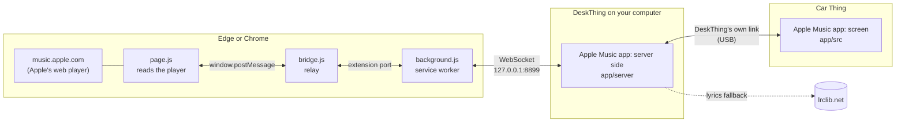
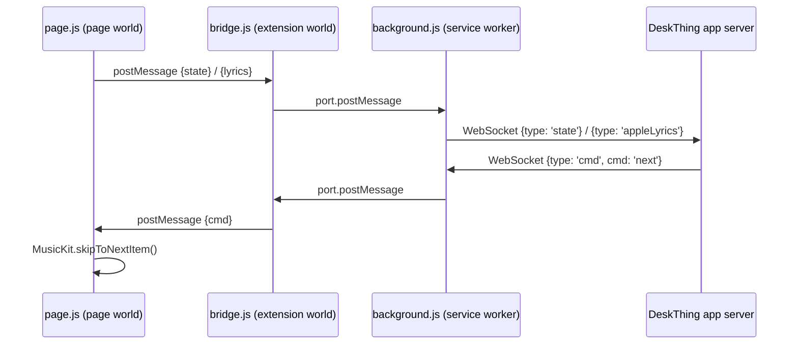
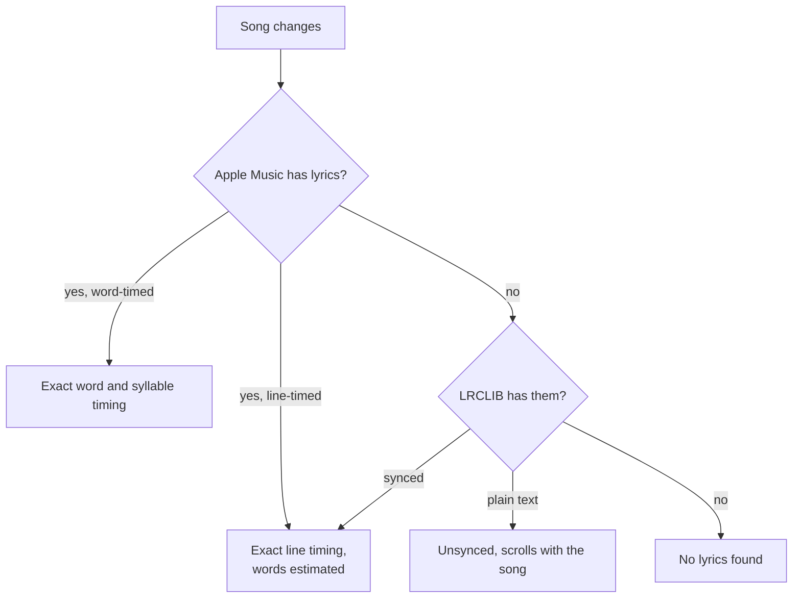

# How it works

This is the technical tour: how the song playing in a browser tab ends up on a Car Thing, how lyrics and album art are found, and how a turn of the dial makes it back to Apple Music. For setup and everyday use, see the [README](../README.md).

## The big picture

Three pieces of code, in three places:

| Piece | Runs on | Code | Job |
|---|---|---|---|
| **Browser extension** (Now Playing Bridge for DeskThing) | your computer, inside Edge or Chrome | [`extension/`](../extension) | Reads the Apple Music web player, fetches Apple's lyrics, carries out playback commands |
| **App, server side** | your computer, inside DeskThing | [`app/server/`](../app/server) | Local bridge to the extension, lyrics lookup, button actions, settings |
| **App, screen** | the Car Thing | [`app/src/`](../app/src) | Draws everything, handles touch, dial and buttons |

Song data never leaves your computer except for the lyrics lookups described below. See the [privacy policy](../PRIVACY.md).

---

## 1. Reading what's playing

**Code:** [`extension/page.js`](../extension/page.js)

Apple Music on the web is built on **MusicKit JS**, Apple's player library. The page creates one player and keeps it at `MusicKit.getInstance()`. Everything the screen needs is on that object:

| Read from MusicKit | Becomes |
|---|---|
| `nowPlayingItem` (title, artist, album, `playParams.id`) | song info and a stable song id |
| `nowPlayingItem.attributes.artwork.url` | album art (see [§5](#5-album-art)) |
| `attributes.durationInMillis` | song length |
| `currentPlaybackTime` | position |
| `isPlaying` / `playbackState` | playing or paused |
| `volume` | Apple Music's volume slider |
| `queue.items[queue.position + 1…]` | the next song, for prefetching |

**Why it runs as a "main world" script.** Extensions normally run in an isolated copy of the page's JavaScript and can't see objects the page created, including the player. `page.js` is declared with `"world": "MAIN"` in the [manifest](../extension/manifest.json), so it runs in the page's own JavaScript and can reach `MusicKit`. It has no extension powers there, which is why a second script (below) does the relaying.

**When it sends an update.** It listens to MusicKit's own events (`nowPlayingItemDidChange`, `playbackStateDidChange`, `playbackVolumeDidChange` and others) and also checks once a second. An update goes out when something meaningful changes: a new song, play/pause, volume, the next song, or a seek (the position is more than 1.5 s from where it should be). While playing, it also resends every 4 s so the Car Thing's clock stays in step.

**Fallback.** If MusicKit can't be reached, it falls back to the browser's Media Session info (title, artist, artwork) plus the page's `<audio>` element (position, play state, volume). That covers the basics but not lyrics or the queue.

## 2. Inside the extension

**Code:** [`extension/page.js`](../extension/page.js) → [`extension/bridge.js`](../extension/bridge.js) → [`extension/background.js`](../extension/background.js)

- **`bridge.js`** is a normal content script on the same page. It relays between the page (`window.postMessage`, tagged so it ignores anything else) and the service worker (a long-lived extension port). If the service worker restarts, it reconnects and resends the last state.
- **`background.js`** is the extension's service worker:
  - **Tracks every Apple Music tab** and follows one: the tab that's playing, otherwise the one updated most recently.
  - **Holds one WebSocket** to `ws://127.0.0.1:<port>/` (default 8899, set in the popup) while an Apple Music tab is open.
  - **Reconnects with backoff** (1 s, doubling to 15 s) if DeskThing isn't running.
  - **Pings every 20 s,** which also keeps Chrome from suspending the worker.
  - **Disconnects** 5 s after the last Apple Music tab closes.
- **The popup** ([`popup.js`](../extension/popup.js)) asks the service worker for status: connection, tab count, current song, port.

## 3. The local bridge in DeskThing

**Code:** [`app/server/bridge.ts`](../app/server/bridge.ts), [`app/server/index.ts`](../app/server/index.ts)

The app's server side runs inside DeskThing and opens a WebSocket server:

- **Local only:** it listens on `127.0.0.1`, so nothing outside your computer can connect.
- **Extensions only:** it refuses any connection whose `Origin` isn't a browser extension (`chrome-extension://…`). Websites open in your browser therefore can't drive playback through it.
- **One browser at a time:** the newest connection wins.

From there it does three jobs:

1. **Passes state to the Car Thing.** Each `state` message is forwarded with DeskThing's `DeskThing.send({ type: 'am', request: 'state', … })`. DeskThing carries it over its own USB link to the app's screen on the Car Thing.
2. **Passes commands back.** The screen sends `am_cmd` messages, and button mappings trigger registered actions. Both become `{ type: 'cmd' }` messages to the extension.
3. **Finds lyrics** (see [§4](#4-lyrics)).

### Commands

| Command | From | What the page does |
|---|---|---|
| `playPause` | dial press, tap controls, mapped button | `mk.play()` / `mk.pause()` |
| `next` | swipe left, hold dial, tap controls | `mk.skipToNextItem()` |
| `prev` | swipe right, tap controls | restart the song if past 3 s, otherwise `mk.skipToPreviousItem()` (like a car stereo) |
| `seek` | dragging the progress bar | `mk.seekToTime()` |
| `volume` | dial, swipe up/down | sets `mk.volume` (Apple Music's slider, not system volume) |

Volume is tracked on the server and the screen as well as in the page, so fast dial turns stack correctly instead of each one starting from a stale value.

The server also registers **DeskThing actions** (Play/Pause, Next, Previous, Volume Up/Down, Toggle Lyrics) so any Car Thing button can be mapped to them in DeskThing's mapping profiles.

## 4. Lyrics

Lyrics come from two places, in this order.

### Apple Music's own lyrics (first choice)

**Code:** [`extension/page.js`](../extension/page.js) (fetch), [`app/server/ttml.ts`](../app/server/ttml.ts) (parse)

The extension asks for the current song's lyrics through the page's own MusicKit API client (`mk.api.music(...)`), the same signed-in session the page uses when you press its lyrics button. It doesn't touch or store any tokens. It tries `/v1/catalog/{storefront}/songs/{id}/syllable-lyrics` first, then `/lyrics`.

Apple returns lyrics as **TTML** (an XML timed-text format) in one of three shapes:

- **Word-timed** (`itunes:timing="Word"`): every word, and sometimes every syllable, has its own start and end. Most newer releases look like this. The parser groups syllables into words where there's no space between them, so "Beau·ti·ful" fills piece by piece.
- **Line-timed** (`itunes:timing="Line"`): each line has an exact start and end. Common on older catalog songs.
- **Untimed:** plain lines.

The parser also skips background vocals (`ttm:role="x-bg"`), as Apple's main lyric line does, and inserts a ♪ break where there's an instrumental gap of more than 9 s.

### LRCLIB (fallback)

**Code:** [`app/server/lyrics.ts`](../app/server/lyrics.ts)

When Apple has no lyrics, the server asks [LRCLIB](https://lrclib.net), a free community lyrics database, for the song:

1. **Exact lookup** (`/api/get`) with title, artist, album and length.
2. **Retry** with a cleaned-up title: no "(feat. …)", "- Remastered" or similar.
3. **Search** (`/api/search`), picking the closest synced result whose length is within 8 s of the song. Anything further off is usually a different version.

LRCLIB returns **LRC** (`[mm:ss.xx]` per line, sometimes `<mm:ss.xx>` per word), which the server parses into the same shape as Apple's lyrics. Results are cached for the last 60 songs.

**Behind a company proxy.** DeskThing's own network requests ignore the system proxy, so on managed networks the direct request can fail. When it does, the server asks the extension to make the same request through the browser, which does use the proxy. The extension only allows `https://lrclib.net` URLs, so this can't be used to fetch anything else. After one failure, the server goes straight to the browser route for 10 minutes.

### Next song, ready in advance

While a song plays, the extension also fetches the **next** song's Apple lyrics and sends them over marked as a prefetch. It keeps the last 12 songs cached. The server holds them until that song starts. If Apple has none, the server looks the next song up on LRCLIB 5 s into the current one. Either way, lyrics are usually on screen the moment the song changes.

### Which source wins

If Apple's synced lyrics arrive, they replace LRCLIB's. Plain (unsynced) Apple lyrics never replace synced LRCLIB lyrics. A lookup that finishes after the song has already changed is thrown away.

## 5. Album art

- **Size:** Apple's artwork URL is a template (`…/{w}x{h}bb.jpg`). The extension fills in 600×600, a little more than the Car Thing needs at its 368 px display size, so it stays sharp.
- **How the Car Thing loads it:** through **DeskThing's image proxy** (`DeskThing.useProxy(url)`), so the computer downloads it and passes it on. The Car Thing never contacts Apple's servers itself.
- **Next song:** the next song's art is loaded into the Car Thing's cache ahead of time.
- **Color:** one sample per song, taken from a 24×24 copy of the art, sets the base color.
- **Blurred backdrop and "Liquid Glass" controls:** the Car Thing's 2018-era browser can't blur what's behind an element live. So once per song, [`app/src/glass.ts`](../app/src/glass.ts) draws the scene behind the controls on a quarter-size canvas: the blurred backdrop plus the art in place, blurred again. Each glass element shows that image, aligned with what's actually behind it and magnified 7% to suggest refraction at the edges. It costs one small canvas render per song and nothing per frame.

## 6. On the Car Thing

**Code:** [`app/src/`](../app/src)

The screen is a React page that DeskThing runs on the Car Thing. It talks to the server side through DeskThing's client SDK ([`link.ts`](../app/src/link.ts)): it listens for `am` messages and sends `am_get` (on start) and `am_cmd` (commands).

### Keeping time without constant updates

Position updates arrive about every 4 s, but the screen moves continuously. It keeps its own clock: last known position plus time elapsed since it arrived ([`App.tsx`](../app/src/App.tsx)). When a fresh position arrives and differs a little (under 1.5 s) from the screen's clock, the difference is **eased in over 0.9 s** instead of jumping, so the lyric fill never stutters. Real seeks and song changes jump immediately.

### Cheap drawing on a slow chip

The Car Thing's processor is slow, so anything that moves every frame skips React and writes straight to the page:

- **Progress bar** ([`Progress.tsx`](../app/src/Progress.tsx)): moves by transform, only when it would shift a whole pixel. The time labels change once a second.
- **Lyric fill** ([`Lyrics.tsx`](../app/src/Lyrics.tsx)):
  - **How words fill:** each word is drawn with a white-to-dim gradient clipped to the letters, and sliding the gradient fills the word left to right. Only words whose fill changed get touched each frame.
  - **Which line is current:** checked 10 times a second. The list only re-renders when the line changes.
  - **Off-screen lines:** only lines from 5 above to 10 below the current one are drawn word by word. The rest keep their space in the layout but aren't painted.

### Estimating word timing

When the source only has line timing, [`timing.ts`](../app/src/timing.ts) spreads each line's time across its words:

- **Syllable estimate:** an English/Spanish syllable count from vowel groups, with fixes for silent "e" and "-ed".
- **Short words:** words like "the" and "de" get less time.
- **Held words:** the line's last word, words before a comma, and drawn-out sounds like "ooh" get more.
- **The sweep:** it starts on the line's exact start and finishes at its exact end when Apple gives one. Otherwise it runs at a sung pace and ends just before the next line starts.

### Input

The app takes over the dial and two buttons from DeskThing while it's open (`DeskThing.overrideKeys`):

| Input | Arrives as | Does |
|---|---|---|
| Dial turn | `wheel` | volume |
| Dial press | `Enter` | play/pause (held 0.6 s: next song) |
| Back button | `Escape` | lyrics on/off (held: DeskThing's app list) |
| Touch | touch events | tap: controls · swipe left/right: next/previous · swipe up/down: volume · drag bar: seek |

## Message reference

**Extension ⇄ app server** (WebSocket, JSON)

| Direction | `type` | Contents |
|---|---|---|
| ext → server | `hello` | extension version |
| ext → server | `state` | `{ hasTrack, id, title, artist, album, artwork, durationMs, positionMs, isPlaying, volume, next }` |
| ext → server | `appleLyrics` | `{ trackId, status: 'ok' \| 'none' \| 'unavailable', ttml }` (current or prefetched) |
| ext → server | `fetchResult` | `{ id, status, body }` or `{ id, error }`, the answer to a `fetch` |
| ext → server | `ping` | keep-alive |
| server → ext | `cmd` | `{ cmd, value }` (see [Commands](#commands)) |
| server → ext | `getState` | asks for the current state |
| server → ext | `fetch` | `{ id, url }`: fetch an lrclib.net URL through the browser |

**App server ⇄ Car Thing screen** (DeskThing SDK). Types are in [`app/shared/types.ts`](../app/shared/types.ts).

| Direction | Message | Contents |
|---|---|---|
| server → screen | `am` / `state` | current song and playback |
| server → screen | `am` / `lyrics` | `{ trackId, status, synced \| plain, source }` |
| server → screen | `am` / `bridge` | `{ connected }`: whether the extension is connected |
| server → screen | `am` / `toggleLyrics` | from a mapped button |
| screen → server | `am_get` | ask for everything (on start) |
| screen → server | `am_cmd` | `{ cmd, value }` |

## A note on stability

MusicKit's player object and the lyrics endpoints are what Apple's own web player uses. They aren't a published API for third parties, so Apple can change them at any time. The extension checks for each piece before using it and falls back where it can: Media Session for song info, LRCLIB for lyrics. If something breaks after an Apple Music update, [`extension/page.js`](../extension/page.js) is where to look first.
